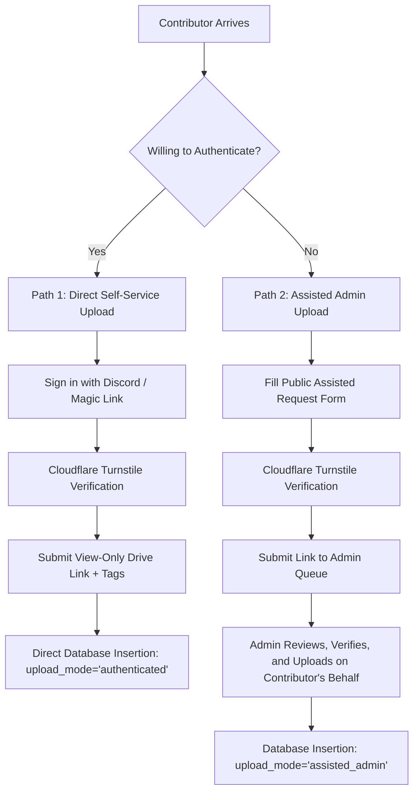

# Drive Ingestion & Search Specification

> **Emergency Community Notice & Platform Scope Disclaimer**  
> **OurArchive** is an emergency, temporary measure to aid fanfiction readers and authors during service outages on primary fanwork archives, and is strictly not intended to replace, compete with, or replicate the permanent operations of existing community fanfiction platforms.

---

## 1. Ingestion Overview

The ingestion pipeline is designed to register view-only Google Drive links with zero server file storage while protecting the system and readers from malicious links, bot spam, and invalid permissions.

---

## 2. Canonical Google Drive Link Validation

To prevent phishing attacks, credential-harvesting redirects, and malicious link poisoning, all submitted URLs are strictly validated using canonical Google domain regular expressions:

### 2.1 Permitted URL Patterns
The ingestion validator only accepts URLs matching:

```regex
^https:\/\/(?:drive\.google\.com\/(?:file\/d\/|drive\/folders\/|open\?id=)|docs\.google\.com\/(?:document\/d\/|presentation\/d\/))([a-zA-Z0-9_-]+)(?:\/view|\/preview|\/edit|\?.*)?$
```

### 2.2 Prohibited URL Patterns
The validator immediately rejects:
- URL shorteners (`bit.ly`, `tinyurl.com`, `t.co`, `goo.gl`, `is.gd`).
- Raw IP addresses or non-canonical hosts (e.g. `drive.google.com.malicious.net`).
- Direct executable downloads (`.exe`, `.scr`, `.bat`, `.apk`, `.vbs`, `.zip`).
- Cloud storage providers other than Google Drive (e.g. Mega, Mediafire, Dropbox) to keep validation uniform and inspectable.

---

## 3. Dual-Path Upload Architecture

To ensure accessibility for all community members while preventing spam, OurArchive provides two distinct submission pathways:



### Path 1: Authenticated Self-Service Upload
- **User Experience**: Contributor signs in instantly using Discord OAuth or Magic Link (managed by Supabase Auth).
- **Benefits**: Contributor can view their submission dashboard, edit metadata (fandom, pairing, rating), or delete their submissions at any time.
- **Accountability**: Submissions are tied to `uploader_user_id`. Malicious spammers can be banned and their submissions bulk-quarantined with a single action.

### Path 2: Assisted Admin Upload
- **User Experience**: For users who do not want to create an account or authenticate, a dedicated intake form allows submitting the link with author attribution.
- **Benefits**: Eliminates barriers to community contributions during high-stress outage windows.
- **Safety Gate**: The link does not enter the public feed automatically; it routes directly to the Administrator triage queue for human verification and upload.

---

## 4. Bot Uploader Detection Heuristics

To prevent botnets from overwhelming the verification queue during an outage:
1. **Cloudflare Turnstile Challenge**: Required on every submission request.
2. **Account Upload Velocity Limit**: Maximum 5 submissions per hour per user account.
3. **IP Velocity Limit**: Maximum 10 submission requests per hour per IP address.
4. **Drive Account Bot Profile Heuristic**:
   - Queries Google Drive API `files.get` with `fields=owners(displayName,emailAddress)`.
   - Inspects the returned Drive owner metadata against known disposable spam email patterns.

---

## 5. View-Only Permission Verification

Before a link is admitted, OurArchive queries the Google Drive API to confirm permissions:
- Queries `capabilities(canEdit, canComment)`.
- **Validation Rule**:
  - `canEdit == false`: Verified as read-only.
  - `canEdit == true`: **REJECTED OR FLAGGED**. If a link grants edit access to the public, the system notifies the contributor to change their Google Drive link settings to `"Anyone with the link can view"` to protect the author's work from vandalism.

---

## 6. Search Architecture & Full-Text Retrieval

Search queries are executed against `vw_public_search_feed` using PostgreSQL `tsvector` full-text search:

```sql
SELECT 
    work_id,
    title,
    author_name,
    fandom,
    summary,
    tags,
    verification_badge,
    ts_rank(search_vector, query) AS rank
FROM public.vw_public_search_feed,
     plainto_tsquery('english', 'Arcane Vi Caitlyn') AS query
WHERE search_vector @@ query
ORDER BY rank DESC
LIMIT 20;
```

### Search Features:
- **Title & Author Priority**: Weighted search (`Weight A`) ensures direct name searches appear first.
- **Tag Filtering**: Instant filtering by rating (`General Audiences`, `Teen`, `Mature`, `Explicit`) and fandom categories.
- **Masked Drive Reveal**: Links are protected from scraper bots and only revealed upon intentional user interaction.
