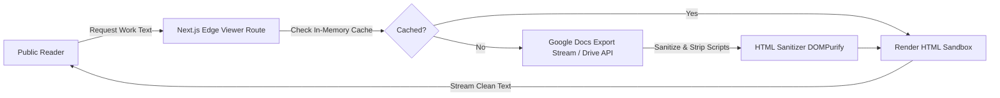

# Reader Sandbox & Anti-Bot Protection

> **Emergency Community Notice & Platform Scope Disclaimer**  
> **OurArchive** is an emergency, temporary measure to aid Archive of Our Own (AO3) users during service outages and is strictly not intended to replace, compete with, or replicate the permanent operations of Archive of Our Own (AO3) or the Organization for Transformative Works (OTW).

---

## 1. Overview & Public Reader Philosophy

Public reading on OurArchive is intentionally designed to be **open, frictionless, and anonymous**:
- Readers do not need to register, log in, or install extensions.
- However, to prevent automated scraper bots, web crawlers, and malicious actors from harvesting Google Drive links or overwhelming free-tier infrastructure, OurArchive implements strict **edge protection and client sandboxing**.

---

## 2. Distraction-Free Reader Sandbox

The reader view delivers a comfortable, accessible reading experience while strictly enforcing the **Zero-Download** rule:

### 2.1 Ephemeral Streaming (No Server File Storage)
- Document content is fetched on-the-fly using Google Drive export endpoints (`/export?mimeType=text/html` or `/export?mimeType=text/plain`).
- Content is buffered ephemerally in serverless memory only for the duration of the HTTP response.
- No `.html`, `.pdf`, or `.txt` files are written to server disks or object buckets.

### 2.2 Content Sanitization Pipeline
Before text is rendered in the reader UI:
- **Script Elimination**: Strips `<script>`, `<embed>`, `<object>`, `<iframe>`, and inline event handlers (`onclick`, `onload`).
- **External Asset Blocking**: Blocks external stylesheets and tracking pixels to prevent IP leaking.
- **Font & Formatting Normalization**: Re-styles content with customizable reader controls (Font Family: Sans / Serif, Font Size, Line Spacing, Light / Dark / Sepia themes).

---

## 3. Public Reader Anti-Bot Defense

To protect the platform against DDoS attacks, automated content scrapers, and malicious botnet harvesting:

### 3.1 Edge Rate-Limiting Tiers (Vercel Edge Middleware)
Edge middleware tracks requests per IP address using lightweight token bucket counters:

| Action / Endpoint | Rate Limit | Action Upon Violation |
| :--- | :--- | :--- |
| **Search Queries** (`/api/search`) | 60 requests / minute | HTTP 429 (Too Many Requests) |
| **Reader View Stream** (`/api/reader/*`) | 30 chapters / minute | HTTP 429 with 30-second backoff |
| **Drive Link Reveal** (`/api/links/reveal`) | 10 reveals / minute | Triggers Cloudflare Turnstile verification challenge |
| **Assisted Upload Intake** (`/api/assisted-intake`) | 3 submissions / hour | Rejection with CAPTCHA block |

### 3.2 Cloudflare Turnstile Bot Deterrence
- Seamless, non-intrusive CAPTCHA challenge running in the background.
- Validates browser fingerprints to block headless browser scraping (`Puppeteer`, `Selenium`, automated Python `requests` crawlers).

---

## 4. Secure Drive Link / Path Reveal Protocol

To prevent automated harvesting while preserving transparency for readers who wish to visit the original source:

1. **Masked Search Card**: Public search results display author and file metadata without outputting the raw `https://drive.google.com/...` hyperlink in HTML.
2. **Intentional Reveal Trigger**:
   - The reader clicks the **`[View Drive Link / Path]`** button on the work card.
   - A secure dialog opens, displaying:
     - The canonical Google Drive URL.
     - The verified View-Only confirmation badge.
     - Drive owner attribution (with email masking if requested).
   - An explicit outbound warning banner:
     > *"You are opening an external Google Drive view-only file. OurArchive has verified view-only status and clean MIME safety."*
   - A direct link: `Open in Google Drive (Read-Only)`.
