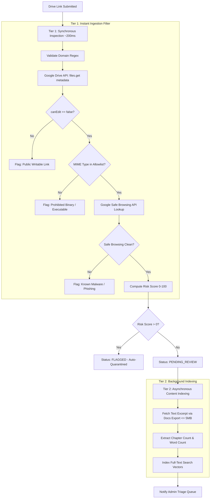
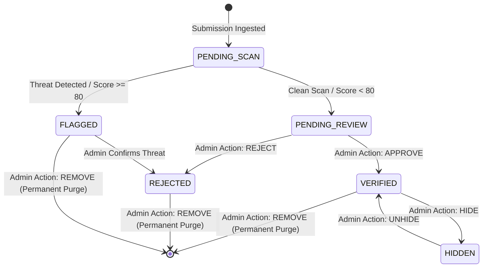

# Security & Verification Pipeline

> **Emergency Community Notice & Platform Scope Disclaimer**  
> **OurArchive** is an emergency, temporary measure to aid fanfiction readers and authors during service outages on primary fanwork archives, and is strictly not intended to replace, compete with, or replicate the permanent operations of existing community fanfiction platforms.

---

## 1. Security Architecture Overview

Because opening arbitrary web links can expose community members to malware, phishing, and malicious exploits, OurArchive implements a rigorous **dual-layer defense model**:
1. **Automated Threat Screening**: Instantaneous, lightweight inspection using Google Drive API metadata and Google Safe Browsing API.
2. **Human Administrator Verification**: An administrative triage queue empowering system operators with a comprehensive **6-Action Suite**.

---

## 2. Two-Tier Automated Threat Scanner

To process thousands of links efficiently without serverless memory overflows, execution timeouts, or bandwidth expenses, the system **never downloads full files**. Instead, it inspects file attributes and metadata via APIs:



### 2.1 MIME Type Allowlist
Only reading and document formats are permitted:
- `application/pdf`
- `text/html`
- `text/plain`
- `application/vnd.google-apps.document` (Google Docs)
- `application/epub+zip`

**Strictly Prohibited Extensions & MIME Types**:
- Executables & Scripts: `.exe`, `.scr`, `.bat`, `.cmd`, `.vbs`, `.js`, `.ps1`, `.apk`, `.msi`.
- Macro-Enabled Office Files: `.docm`, `.xlsm`, `.pptm`.
- Encrypted / Password-Protected Archives.

### 2.2 Risk Scoring Model (0–100)
- **Score 0**: Clean document, verified view-only, clean Google Safe Browsing verdict.
- **Score 30–50**: Missing metadata, unusual MIME type, or newly created uploader account.
- **Score 80–100**: Direct executable extension, Google Safe Browsing alert, or public edit permissions enabled. Any link scoring ≥ 80 is immediately quarantined with `status = 'flagged'`.

---

## 3. Administrator 6-Action Suite

System administrators review links in the triage dashboard. The operator has six direct administrative actions available for every link record:

| Action | Technical Execution | State Transition | Audit Log Record |
| :--- | :--- | :--- | :--- |
| **1. VERIFY** | Re-triggers the automated threat scanner, queries live Drive API metadata, and inspects public owner details. | `pending_scan` -> `pending_review` | `admin_actions: action_type='VERIFY'` |
| **2. APPROVE** | Validates the work as genuine fanfiction and safe. Issues the `VERIFIED BY ADMIN` badge and publishes to public search. | `pending_review` -> `verified` (`is_hidden=FALSE`) | `admin_actions: action_type='APPROVE'` |
| **3. REJECT** | Marks the link as ineligible (e.g. broken permissions, non-fanfic media, commercial piracy). Excludes from public search. | `pending_review` -> `rejected` | `admin_actions: action_type='REJECT'` |
| **4. HIDE** | Instantly toggles visibility off without deleting data. Used for temporary review or upon owner request. | Any status -> `is_hidden = TRUE` | `admin_actions: action_type='HIDE'` |
| **5. CONTACT** | Generates a direct communication prompt or notification to the submitter or Drive owner regarding permissions or metadata. | Maintains current status | `admin_actions: action_type='CONTACT'` |
| **6. REMOVE** | Permanently expunges the link and all cascading metadata, search vectors, and audit logs immediately. | Record Deleted from PostgreSQL | Cascade Deletion Completed |

---

## 4. State Machine & Status Transitions



---

## 5. Incident Response & Immediate Takedowns

When an author, Drive owner, or community member submits a takedown notice:
1. **Zero-Delay Hide**: Admin executes **HIDE** in seconds, removing the work from search feeds and viewer proxies immediately.
2. **Permanent Cascade Purge**: Admin executes **REMOVE**, issuing:
   ```sql
   DELETE FROM public.drive_links WHERE id = '<target_link_id>';
   ```
   PostgreSQL `ON DELETE CASCADE` constraints automatically delete all associated records in `link_metadata` and `link_verifications`.
3. **Audit Closure**: An entry is recorded in the administrative log confirming the takedown request was satisfied.
