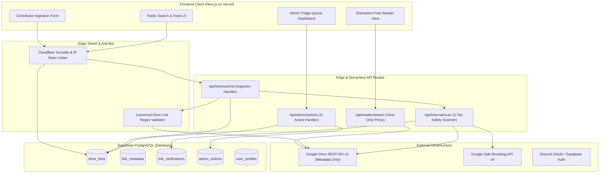
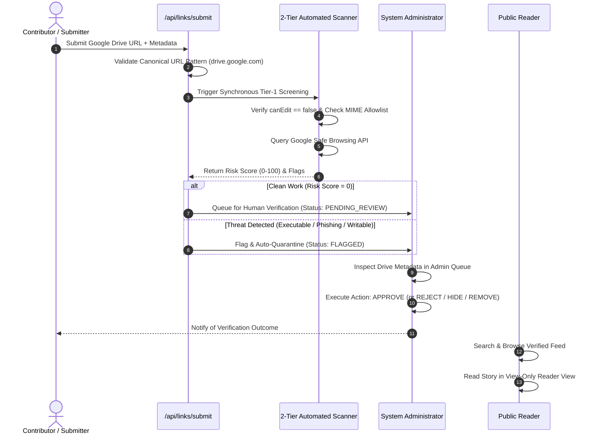

# System Architecture & Operational Overview

> **Emergency Community Notice & Platform Scope Disclaimer**  
> **OurArchive** is an emergency, temporary measure to aid fanfiction readers and authors during service outages on primary fanwork archives, and is strictly not intended to replace, compete with, or replicate the permanent operations of existing community fanfiction platforms.

---

## 1. System Mission & Usage Model

OurArchive provides a non-commercial, resilient emergency bridge for the fanfiction community when primary fanwork archives suffer temporary service downtime.

### Core Architectural Axiom: Zero-Download / Read-Only
The platform operates exclusively as an index and streaming reader proxy:
- **No Physical File Storage**: The system never downloads, hosts, or duplicates fanfiction files (`.pdf`, `.epub`, `.html`, Google Docs) on server storage.
- **Ephemeral Read-Only Access**: Document text is retrieved on-demand directly from the author's public view-only Google Drive link and rendered in a clean reader view.
- **Immediate Takedown Sovereignty**: If an author or Drive owner requests removal, the link is permanently purged immediately (see [Takedown Policy](../disclaimers/takedown_and_removal_request.md)).

---

## 2. System Actors

| Actor | Role & Capabilities | Authentication Level |
| :--- | :--- | :--- |
| **Public Reader** | Searches works by fandom, author, or tags; reads in view-only mode; reveals Drive links on demand. | Anonymous / Public (Protected by bot defense) |
| **Contributor (Uploader)** | Submits public view-only Google Drive links, fills metadata tags, and tracks submission status. | Authenticated via Supabase Auth (Discord / Magic Link) |
| **Unauthenticated Submitter** | Submits links directly to the Administrator via the Assisted Admin Upload channel. | Anonymous (Admin verifies and uploads on behalf) |
| **Automated Safety Scanner** | Internal background scanner verifying canonical Drive URLs, MIME types, scripts, and domain safety. | System Service / Edge Function |
| **System Administrator** | Triages submitted links with the 6-Action Suite: **VERIFY**, **APPROVE**, **REJECT**, **HIDE**, **CONTACT**, **REMOVE**. | Authenticated (Role: `admin`) |

---

## 3. High-Level Component Topology

---

## 4. End-to-End Ingestion & Verification Lifecycle

---

## 5. Architectural Directory Index

Detailed domain specifications are cross-referenced below using relative file paths:

- [Drive Ingestion & Search Specification](drive_ingestion_and_search.md)
- [Security & Verification Pipeline (Automated Scanner & Admin Suite)](security_and_verification_pipeline.md)
- [Reader Sandbox & Anti-Bot Protection](reader_and_anti_bot_protection.md)
- [Database Schema & Search Projections](../database/search_and_display_projection.md)
- [Community Disclaimers & Takedown](../disclaimers/takedown_and_removal_request.md)
