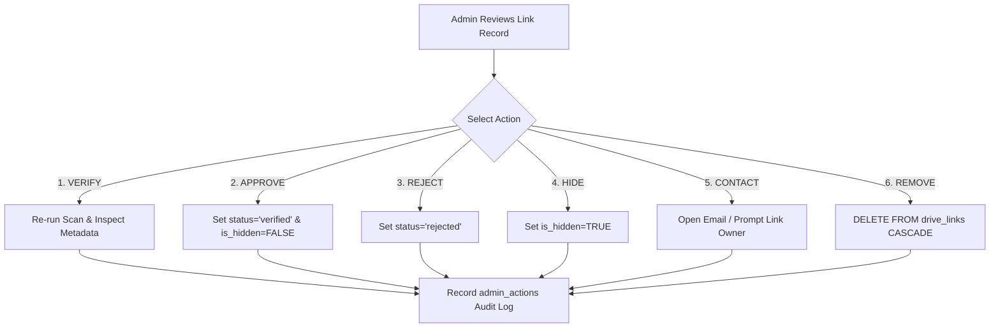

# Module 3 Specification: Threat Scanning & Admin 6-Action Suite

> **Module:** Module 3 — Verification, Safety & Disclaimers  
> **Commit Codes:** `OA-M3-F1`, `OA-M3-F2`, `OA-M3-F3`

---

## 1. Automated Threat Scoring Algorithm

When a link enters Tier 1 screening, a composite risk score (0–100) is calculated:

```typescript
export interface ScanResult {
  riskScore: number;
  flags: string[];
  passed: boolean;
}

export function evaluateDriveThreat(metadata: DriveMetadata, safeBrowsingClean: boolean): ScanResult {
  let score = 0;
  const flags: string[] = [];

  // 1. Google Safe Browsing Verdict
  if (!safeBrowsingClean) {
    score += 100;
    flags.push('MALWARE_PHISHING_DOMAIN_DETECTED');
  }

  // 2. MIME Type Validation
  const ALLOWED_MIMES = [
    'application/pdf',
    'text/html',
    'text/plain',
    'application/vnd.google-apps.document',
    'application/epub+zip'
  ];
  if (!ALLOWED_MIMES.includes(metadata.mimeType)) {
    score += 80;
    flags.push(`PROHIBITED_MIME_TYPE: ${metadata.mimeType}`);
  }

  // 3. Permission Check
  if (metadata.canEdit) {
    score += 80;
    flags.push('PUBLIC_WRITABLE_LINK');
  }

  // 4. File Extension Inspection
  const DANGEROUS_EXTS = ['.exe', '.scr', '.bat', '.cmd', '.vbs', '.js', '.apk', '.docm'];
  if (DANGEROUS_EXTS.some(ext => metadata.fileName.toLowerCase().endsWith(ext))) {
    score += 100;
    flags.push('EXECUTABLE_EXTENSION_DETECTED');
  }

  return {
    riskScore: Math.min(score, 100),
    flags,
    passed: score === 0
  };
}
```

---

## 2. Administrator 6-Action Execution Contracts

When an administrator reviews a submission in `/admin/queue`, they execute one of six actions:



### Audit Trail Enforcement
Every action inserts an immutable record into `public.admin_actions`:
```sql
INSERT INTO public.admin_actions (link_id, admin_id, action_type, reason)
VALUES ('7f891b2c-3d4e-5f6a-7b8c-9d0e1f2a3b4c', auth.uid(), 'APPROVE', 'Verified view-only Heartstopper fanfiction mirror.');
```
