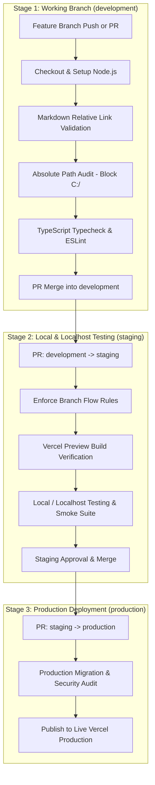

# OurArchive CI/CD & Delivery Architecture

> **Emergency Community Notice & Platform Scope Disclaimer**  
> **OurArchive** is an emergency, temporary measure to aid Archive of Our Own (AO3) users during service outages and is strictly not intended to replace, compete with, or replicate the permanent operations of Archive of Our Own (AO3) or the Organization for Transformative Works (OTW).

---

## 1. Overview & Pipeline Philosophy

The Continuous Integration and Continuous Delivery (CI/CD) system for OurArchive is designed for rapid, secure, and reproducible deployments while preventing regressions, broken links, or unauthorized modifications during emergency operations.

All automated pipelines are hosted via **GitHub Actions** and deploy preview and production builds to **Vercel** with database state managed in **Supabase**.

---

## 2. Progressive Three-Stage Delivery & Verification Pipeline

Adapted from the enterprise testing standard of `TRACE_Backend`, OurArchive employs a progressive three-stage pipeline to optimize development agility while securing live production releases:

### Stage 1: Active Working Branch Checks (`development`)
- **Role**: `development` is the primary integration working branch.
- **Trigger**: Every push and Pull Request targeting `development` from feature branches.
- **Jobs**:
  1. **Documentation Link Integrity**: Parses all Markdown files to verify relative file paths and validate that internal links point to existing files.
  2. **Absolute Path Shield**: Verifies that documentation links do not contain local absolute file paths or machine-specific drive letters (`C:\`, `D:\`) to ensure zero-defect portability.
  3. **Code Syntax & Static Analysis**: Runs TypeScript type-checking (`tsc --noEmit`) and ESLint.

### Stage 2: Staging Gate for Local/Localhost Testing (`staging`)
- **Role**: Intermediate verification gate for pre-release validation.
- **Trigger**: Pull Request from `development` into `staging`.
- **Purpose**:
  1. Allows archivists and developers to pull the `staging` branch locally and conduct rigorous localhost testing (`pnpm dev`, smoke tests, and manual scenario walk-throughs).
  2. Ensures that all combined changes on `development` execute cleanly together before live deployment.

### Stage 3: Live Production Deployment Gate (`production`)
- **Role**: Production branch powering live community users on Vercel.
- **Trigger**: Pull Request from `staging` into `production`.
- **Jobs & Safeguards**:
  1. **Strict Branch Flow**: Production PRs must originate from a verified `staging` branch.
  2. **Vercel Build Verification**: Validates production Next.js compilation, route bundling, and Edge middleware sizing.
  3. **Database Migration Audit**: Confirms Supabase production migrations (schema DDL, triggers, and RLS policies) are applied.

---

## 3. GitHub Actions Workflows

The repository uses the following GitHub Actions workflows under [`.github/workflows/`](../.github/workflows/):

### 1. `ci.yml` (Core CI Gate)
- Enforces branch flow validation across `development`, `staging`, and `production`.
- Audits documentation for hardcoded absolute paths.
- Validates internal relative markdown link integrity.
- Executes TypeScript typechecking and ESLint gates.

### 2. `sync-prs.yml` (Stakeholder Tracking - Optional Integration)
- Adapted from the TRACE ecosystem: uses `actions/github-script@v7` on PR lifecycle events (`opened`, `synchronize`, `closed`, `merged`).
- Parses commit/PR backlog tags formatted as `[OA-M#-F#]`.
- Dispatches event payloads to a Google Apps Script webhook to maintain live development dashboards.

---

## 4. Branching Strategy & Delivery Matrix

| Branch | Role | Direct Push Allowed? | Required PR Base | Deployment Target |
| :--- | :--- | :--- | :--- | :--- |
| **`production`** | Live Production Release | No | `staging` | Vercel Production (`ourarchive.org` / live domain) |
| **`staging`** | Local / Localhost Testing & Pre-Release | No | `development` | Localhost Testing / Vercel Staging |
| **`development`** | Active Working Branch | No | Feature branch | Local Dev / Vercel Preview |
| **`docs/*` / `<type>/<changes>`** | Feature & Spec Work | Yes (feature branch only) | `development` | Local / Ephemeral branch preview |

---

## 5. Environment Secrets & Access Control

The following secrets are managed in GitHub Repository Settings (`Settings -> Secrets and variables -> Actions`):

| Secret Name | Purpose | Scope |
| :--- | :--- | :--- |
| `VERCEL_TOKEN` | Token for Vercel CLI deployments | Build & Deploy |
| `VERCEL_ORG_ID` | Vercel Organization ID | Deployment Routing |
| `VERCEL_PROJECT_ID` | Vercel Project ID | Deployment Routing |
| `NEXT_PUBLIC_SUPABASE_URL` | Supabase API Gateway URL | Frontend & CI Integration |
| `NEXT_PUBLIC_SUPABASE_ANON_KEY` | Public anonymous Supabase key | Frontend & CI Integration |
| `SUPABASE_SERVICE_ROLE_KEY` | Administrative service key | Backend Edge Functions |
| `GOOGLE_SAFE_BROWSING_API_KEY` | Key for automated malware link checks | Internal Threat Scanner |

---

## 6. Developer Guidelines & Skill Integration

When working on OurArchive features:
1. Always use `.agents/skills/git-commits/SKILL.md` to format commits with Conventional Commits and `[OA-M#-F#]` tags.
2. Always use `.agents/skills/github-pr/SKILL.md` to manage branch creation off `development` and automate PR drafting.
3. Keep all documentation links relative to ensure portability across local clones and production documentation hosts.
