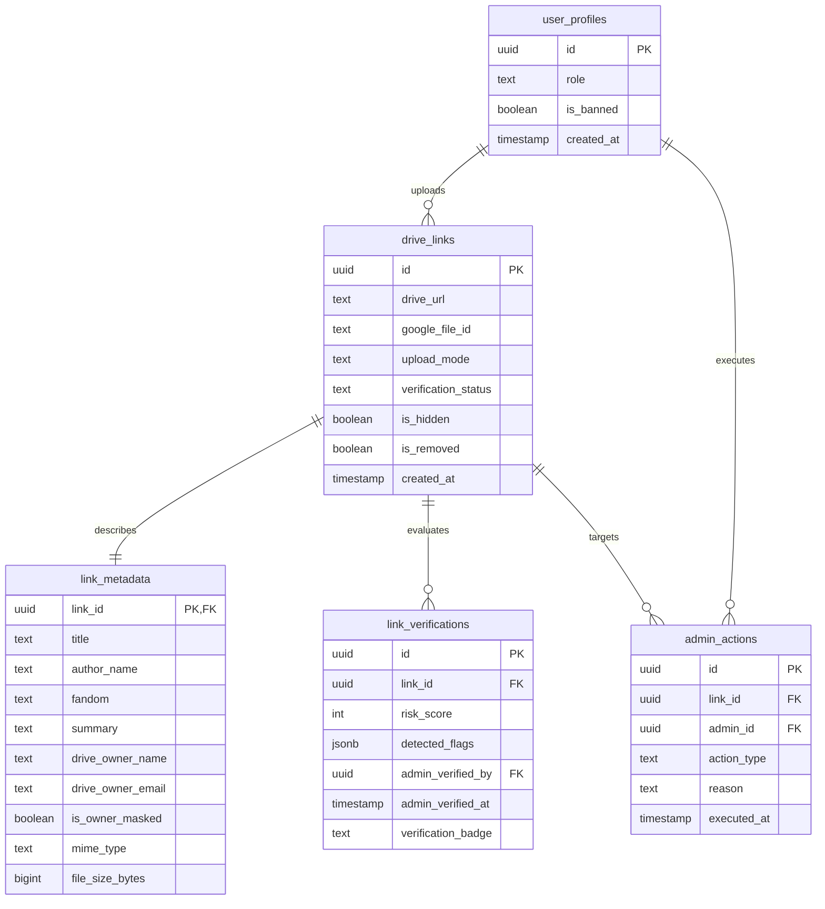

# OurArchive Database Architecture & Contracts

> **Emergency Community Notice & Platform Scope Disclaimer**  
> **OurArchive** is an emergency, temporary measure to aid Archive of Our Own (AO3) users during service outages and is strictly not intended to replace, compete with, or replicate the permanent operations of Archive of Our Own (AO3) or the Organization for Transformative Works (OTW).

---

## 1. Database Engine & Hosting Overview

OurArchive utilizes **PostgreSQL 15+** managed on **Supabase** free tier. The database serves as the persistent metadata index and security enforcement engine for the emergency library.

### Core Architectural Mandates
1. **Zero-Download / Zero File Storage**: The database does NOT store binary fanfiction files (`.pdf`, `.epub`, blobs). It strictly stores Google Drive URL pointers, extracted work metadata (fandom, pairing, rating, word count), and safety verification logs.
2. **Row-Level Security (RLS)**: Public client access is gated by RLS policies so that only verified and unhidden links can be queried by public readers.
3. **Idempotent Schema Migrations**: All table definitions, foreign keys, and indexes are tracked in SQL migrations designed to execute idempotently.

---

## 2. Database Documentation Index

All technical database specifications are cross-referenced below using relative file paths:

| Specification Document | Scope & Contents | Relative Link |
| :--- | :--- | :--- |
| **Schema Definition** | DDL tables for `drive_links`, `link_metadata`, `link_verifications`, `admin_actions`, and `user_profiles` | [schema_definition.md](schema_definition.md) |
| **Search & Display Projection** | UI display contract (`SYSTEM HEADER` -> `{displayed file}` + `{file details & hide option}`) | [search_and_display_projection.md](search_and_display_projection.md) |
| **Indexes & Performance** | PostgreSQL `tsvector` GIN full-text search indexes and composite B-tree performance tuning | [indexes_and_performance.md](indexes_and_performance.md) |

---

## 3. Entity-Relationship Overview

---

## 4. Connection Topology & Pooling

- **Connection Pooler (PgBouncer)**: Transaction mode on port `6543` for stateless edge functions (Vercel API routes and Supabase Edge Functions).
- **Direct Connection**: Session mode on port `5432` for administrative database migrations and batch indexing scripts.
- **Client Security**: Frontend queries access PostgreSQL via Supabase PostgREST client using the anonymous public key (`NEXT_PUBLIC_SUPABASE_ANON_KEY`) subject to active RLS rules.
