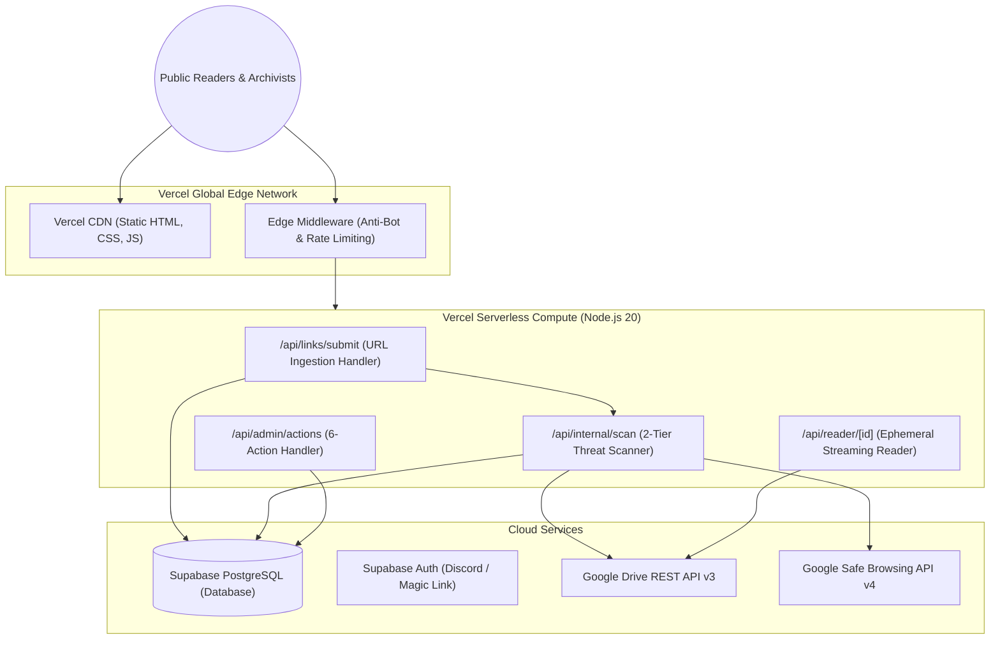

# Hosting & Deployment Infrastructure (Vercel & Edge)

> **Emergency Community Notice & Platform Scope Disclaimer**  
> **OurArchive** is an emergency, temporary measure to aid Archive of Our Own (AO3) users during service outages and is strictly not intended to replace, compete with, or replicate the permanent operations of Archive of Our Own (AO3) or the Organization for Transformative Works (OTW).

---

## 1. Hosting Architecture Overview

OurArchive is deployed as a modern, serverless Next.js web application hosted on **Vercel** (with secondary support for Netlify or Cloudflare Pages). 

Deploying on Vercel enables:
- **Global Edge Network**: Low-latency static asset delivery and edge middleware execution for readers worldwide.
- **Serverless API Routes**: Auto-scaling ingestion handlers and reader proxies that scale with sudden community traffic spikes during AO3 outages without manual server provisioning.
- **Zero-Download Ephemeral Streaming**: Serverless memory buffers incoming text from Google Drive without persisting files to disk.

---

## 2. Infrastructure Topology



---

## 3. Serverless Execution Guardrails

To operate reliably within Vercel free/hobby tier limits while maintaining zero-download compliance:

### 3.1 Function Timeout Constraints
- **Default Timeout**: 10 seconds (standard Vercel serverless limit).
- **Ingestion Execution Target**: Under 1,500ms (Regex validation, Turnstile verification, and Tier-1 Drive API metadata lookup).
- **Streaming Reader Execution**: Direct chunked streaming to the client browser to avoid memory buffering overflows.

### 3.2 Ephemeral Memory Safeguards
- Vercel functions are allocated 1,024 MB memory.
- Large fanfiction files (e.g. multi-megabyte Google Docs) are capped at a maximum of 5MB exported text. If an export exceeds 5MB, the stream is paginated or chunked by chapter rather than loaded entirely into serverless memory.

---

## 4. Edge Middleware & Anti-Bot Protection

Vercel Edge Middleware (`middleware.ts`) executes at the edge before requests hit serverless functions:

```typescript
// Conceptual Edge Middleware Pattern
import { NextResponse } from 'next/server';
import type { NextRequest } from 'next/server';

export async function middleware(request: NextRequest) {
  const ip = request.ip ?? '127.0.0.1';
  const path = request.nextUrl.pathname;

  // Rate limit public reader search queries: max 60 req/min
  if (path.startsWith('/api/search')) {
    const isAllowed = await checkRateLimit(ip, 'search', 60);
    if (!isAllowed) {
      return new NextResponse('Rate limit exceeded. Please wait a moment.', { status: 429 });
    }
  }

  // Rate limit drive link reveals: max 10 reveals/min
  if (path.startsWith('/api/links/reveal')) {
    const isAllowed = await checkRateLimit(ip, 'reveal', 10);
    if (!isAllowed) {
      return new NextResponse('Link reveal rate limit reached.', { status: 429 });
    }
  }

  return NextResponse.next();
}
```

---

## 5. Environment Configuration Matrix

The following environment variables are configured in the Vercel Project Dashboard:

| Variable Name | Environment | Purpose | Sensitivity |
| :--- | :--- | :--- | :--- |
| `NEXT_PUBLIC_APP_URL` | All | Canonical base URL (`https://ourarchive.org`) | Public |
| `NEXT_PUBLIC_SUPABASE_URL` | All | Supabase project API gateway endpoint | Public |
| `NEXT_PUBLIC_SUPABASE_ANON_KEY` | All | Supabase anonymous client API key | Public (Protected by RLS) |
| `SUPABASE_SERVICE_ROLE_KEY` | Server Only | High-privilege key for admin actions and safety scanning | **Critical Secret** |
| `GOOGLE_DRIVE_API_KEY` | Server Only | API key for read-only `files.get` metadata inspection | **Secret** |
| `GOOGLE_SAFE_BROWSING_API_KEY` | Server Only | API key for automated malicious URL verification | **Secret** |
| `CLOUDFLARE_TURNSTILE_SECRET_KEY` | Server Only | Server-side validation key for Turnstile tokens | **Secret** |
| `NEXT_PUBLIC_CLOUDFLARE_TURNSTILE_SITE_KEY` | Client Only | Public site key for client Turnstile widget | Public |

---

## 6. Deployment Pipeline & Branch Promotion

1. **Feature Previews**: Pull Requests targeting `development` generate an ephemeral Vercel Preview Deployment URL for verification.
2. **Staging**: Merges into `staging` deploy to the staging environment (`staging.ourarchive...`).
3. **Production**: Merges into `main` deploy instantly to the production domain (`ourarchive.org`).
