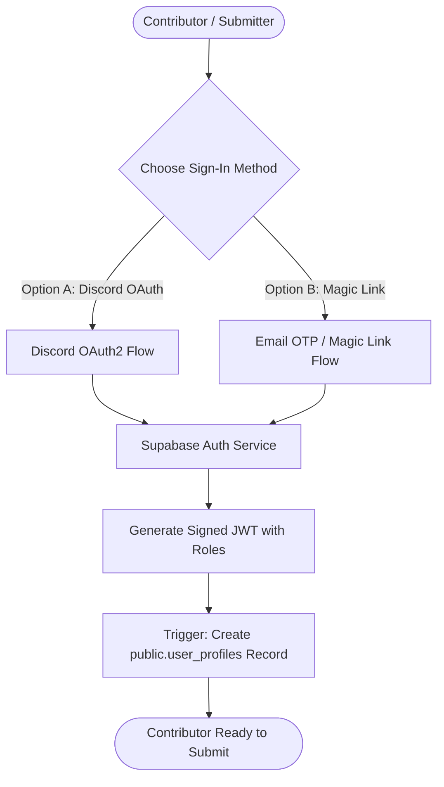

# Supabase Platform Architecture & Integration

> **Emergency Community Notice & Platform Scope Disclaimer**  
> **OurArchive** is an emergency, temporary measure to aid Archive of Our Own (AO3) users during service outages and is strictly not intended to replace, compete with, or replicate the permanent operations of Archive of Our Own (AO3) or the Organization for Transformative Works (OTW).

---

## 1. Supabase Platform Overview

**Supabase** provides the backend infrastructure powering OurArchive. Utilizing Supabase's managed open-source ecosystem eliminates the operational overhead of running dedicated backend containers while ensuring strong security guarantees through PostgreSQL Row-Level Security (RLS).

### Core Integrated Modules
1. **Supabase Auth**: Frictionless identity via Discord OAuth and Email Magic Links.
2. **PostgreSQL 15+ Engine**: Relational storage for links, metadata, and audit logs.
3. **Database Webhooks**: Instant event dispatch to automated safety scanning edge functions.
4. **PostgREST API Gateway**: Instant, type-safe RESTful API secured by RLS policies.

---

## 2. Authentication Architecture (Supabase Auth)

To minimize friction for fanfiction archivists while blocking spam bots, OurArchive uses two streamlined login providers:



### 2.1 Provider Configurations
- **Discord OAuth**: Highly familiar to fanfiction authors and fandom communities. Zero password management, instant sign-in.
- **Email Magic Link**: Fallback for users without Discord; sends a secure, passwordless one-time login link via SMTP.

### 2.2 JWT Role Embedding & Admin Claims
Administrative users (`role = 'admin'`) have custom claims embedded directly into their Supabase JWT `app_metadata`:
```json
{
  "sub": "9f81b2c3-4d5e-6f7a-8b9c-0d1e2f3a4b5c",
  "email": "admin@ourarchive.org",
  "app_metadata": {
    "role": "admin"
  },
  "user_metadata": {
    "display_name": "biboy"
  }
}
```
This claim is evaluated directly inside PostgreSQL RLS policies without requiring repetitive cross-table subqueries.

---

## 3. Database Webhooks & Automated Safety Dispatch

When a new Google Drive link is submitted, Supabase uses native PostgreSQL triggers and Database Webhooks to trigger automated safety scanning:

```sql
-- Trigger Function: Dispatch Webhook to Threat Scanner
CREATE OR REPLACE FUNCTION public.trig_fn_dispatch_safety_scan()
RETURNS TRIGGER AS $$
BEGIN
    -- Only dispatch for newly created links in 'pending_scan' state
    IF NEW.verification_status = 'pending_scan' THEN
        PERFORM net.http_post(
            url := current_setting('app.settings.scan_webhook_url', true),
            headers := jsonb_build_object(
                'Content-Type', 'application/json',
                'X-Scanner-Secret', current_setting('app.settings.scanner_secret', true)
            ),
            body := jsonb_build_object(
                'link_id', NEW.id,
                'drive_url', NEW.drive_url,
                'google_file_id', NEW.google_file_id
            )
        );
    END IF;
    RETURN NEW;
END;
$$ LANGUAGE plpgsql SECURITY DEFINER;

CREATE OR REPLACE TRIGGER on_drive_link_created_dispatch_scan
AFTER INSERT ON public.drive_links
FOR EACH ROW
EXECUTE FUNCTION public.trig_fn_dispatch_safety_scan();
```

---

## 4. Row-Level Security (RLS) Hardening

PostgreSQL Row-Level Security guarantees that:
- Anonymous public readers can **only** read links where `verification_status = 'verified'` and `is_hidden = FALSE`.
- Authenticated contributors can **only** edit or delete their own unverified submissions.
- Only users with the `admin` role claim can execute verification overrides, status changes, or permanent purges.

For complete RLS DDL rules, see the [Database Schema Definition](../database/schema_definition.md).

---

## 5. Idempotent Migration Lifecycle

Database migrations are tracked in SQL version files (e.g. `db/migrations/001_initial_schema.sql`):
1. **Local Development**: Tested using the Supabase CLI (`supabase db reset`).
2. **CI Validation**: Tested during GitHub Actions regression runs.
3. **Production Deployment**: Executed idempotently using `supabase db push` or direct psql connections during scheduled maintenance.
